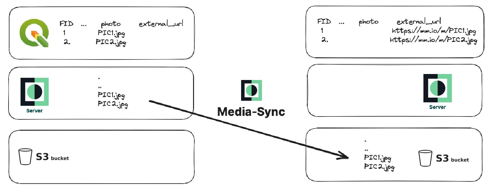

# Mergin Maps Media Sync
Sync media files from Mergin Maps projects to other storage backends. Currently, supported backends are AWS S3 (and S3-compatible storage), Google Drive and local drive (mostly used for testing).

Sync works in two modes, in COPY mode, where media files are only copied to external drive and MOVE mode, where files are
subsequently removed from Mergin Maps project (on cloud).

Also user can choose whether references to media files should be updated.

Only files needed for the sync are downloaded from the Mergin Maps project to the local working directory - media files
with `allowed_extensions` (under `base_path` if set) and geopackages listed in `references`. Other project files (e.g. QGIS project,
basemaps) are not downloaded. If the configuration of synced files changes, the project is downloaded again.

**IMPORTANT**: structure of the config file was changed in the latest version. Therefore old .ini config files should be migrated and enviromnent values should be updated.

### Quick start

Not sure where to start? Check out our [quick start](docs/quick_start.md) guide to set up sync from a new Mergin Maps project to your AWS S3 bucket.

<a href="https://community.merginmaps.com">Join our community</a> and ask questions!

Basic principle is that media-sync deamon COPY or MOVE your pictures from Mergin Maps server to other storage backend. Here is an example of MOVE operation:


#### Running with Docker
To run the container, use a command like the following one:
```shell
  docker run -it \
  -e MERGIN__USERNAME=john \
  -e MERGIN__PASSWORD=myStrongPassword \
  -e MERGIN__PROJECT_NAME=john/my_project \
  lutraconsulting/mergin-media-sync python3 media_sync_daemon.py
```
The sync process will start, regularly checking Mergin Maps service copy/move media files from a Mergin Maps project to an external storage.
Local drive is a default backend, you need to mount volume from host machine for data to persist.

#### Update reference table in geopackage
If you'd like to update references to media files (probably useful with MOVE mode), you can run:
```shell
docker run -it \
  -v /tmp/mediasync:/data \
  --name mergin-media-sync \
  -e MERGIN__USERNAME=john \
  -e MERGIN__PASSWORD=myStrongPassword \
  -e MERGIN__PROJECT_NAME=john/my_project \
  -e LOCAL__DEST=/data \
  -e OPERATION_MODE=move \
  -e REFERENCES = "[{file='my_survey.gpkg', table='my_table', local_path_column='col_with_path', driver_path_column='col_with_ext_url'}]" \
  lutraconsulting/mergin-media-sync python3 media_sync_daemon.py
```
Make sure you have correct structure of you .gpkg file. Otherwise leave all `REFERENCE__` variables empty.

#### Using S3 backend
To upload files to AWS S3 bucket, switch to `s3` driver:
```shell
docker run -it \
  --name mergin-media-sync \
  -e MERGIN__USERNAME=john \
  -e MERGIN__PASSWORD=myStrongPassword \
  -e MERGIN__PROJECT_NAME=john/my_project \
  -e DRIVER=s3 \
  -e S3__BUCKET=my-media-bucket \
  -e S3__REGION=eu-west-1 \
  -e S3__ACCESS_KEY=access-key \
  -e S3__SECRET_KEY=secret-key \
  -e S3__CREATE_BUCKET=false \
  lutraconsulting/mergin-media-sync python3 media_sync_daemon.py
```

**Please note double underscore `__` is used to separate [config](config.yaml.default) group and item.**

Files are uploaded with `Content-Type` based on their extension (e.g. `image/jpeg`), so browsers and QGIS can display
them directly. URLs written to references look like `https://my-media-bucket.s3.eu-west-1.amazonaws.com/images/photo.jpg`.
To make them work for users of your project, objects in the bucket need to be readable - see [AWS S3 setup](docs/aws-s3-setup.md)
for how to create the bucket, make it readable and create credentials with minimal permissions.

| Setting | Description |
|---|---|
| `S3__BUCKET` | Name of the bucket (required). |
| `S3__REGION` | AWS region of the bucket, e.g. `eu-west-1`. Required for AWS S3. |
| `S3__ACCESS_KEY`, `S3__SECRET_KEY` | Access key of IAM user. If not set, [default AWS credentials chain](https://boto3.amazonaws.com/v1/documentation/api/latest/guide/credentials.html) is used (e.g. `AWS_*` environment variables or IAM role). |
| `S3__ENDPOINT` | Leave empty for AWS S3. For S3-compatible server either `host:port` or full URL, e.g. `https://s3.example.com`. |
| `S3__SECURE` | Use https for `S3__ENDPOINT` without scheme (default `true`). |
| `S3__BUCKET_SUBPATH` | Optional folder within the bucket to store files in, files are stored in the root of the bucket by default. |
| `S3__PUBLIC_URL` | Optional base URL used in references instead of the bucket URL, e.g. when files are served through CDN or reverse proxy. |
| `S3__ADDRESSING_STYLE` | `auto` (default), `path` or `virtual`. Some S3-compatible servers need `path`. |
| `S3__CREATE_BUCKET` | Create the bucket if it does not exist (default `true`). Set to `false` if the bucket is managed elsewhere and the user has no permission to create buckets. |

##### S3-compatible storage
Any S3-compatible storage can be used by setting `S3__ENDPOINT`, e.g. for a self-hosted server:
```shell
docker run -it \
  --name mergin-media-sync \
  -e MERGIN__USERNAME=john \
  -e MERGIN__PASSWORD=myStrongPassword \
  -e MERGIN__PROJECT_NAME=john/my_project \
  -e DRIVER=s3 \
  -e S3__ENDPOINT="https://s3.example.com" \
  -e S3__ACCESS_KEY=access-key \
  -e S3__SECRET_KEY=secret-key \
  -e S3__BUCKET=destination-bucket \
  -e S3__ADDRESSING_STYLE=path \
  lutraconsulting/mergin-media-sync python3 media_sync_daemon.py
```
We test with open source RustFS, Garage, SeaweedFS and Silo (community maintained MinIO fork) - see
[S3-compatible storage](docs/s3-compatible.md) for how to run them with media-sync and make uploaded files readable.

##### Migration from MinIO driver
`minio` driver was renamed to `s3`. The old `DRIVER=minio` and `MINIO__*` variables still work, but they are deprecated
and a warning is printed. To migrate, set `DRIVER=s3` and rename `MINIO__*` variables to `S3__*` (e.g. `MINIO__ACCESS_KEY`
to `S3__ACCESS_KEY`). Note that `S3__SECURE` defaults to `true`, while `MINIO__SECURE` defaulted to `false` -
set `S3__SECURE=false` (or use `http://` in `S3__ENDPOINT`) if your server does not use https.

Files uploaded by older versions of media-sync were stored as `application/octet-stream`. New uploads get the correct
`Content-Type`, existing objects are not changed. You can fix them for example with AWS CLI (repeat for other extensions):
```shell
aws s3 cp s3://my-media-bucket/ s3://my-media-bucket/ --recursive \
  --exclude "*" --include "*.jpg" --include "*.jpeg" \
  --metadata-directive REPLACE --content-type image/jpeg
```
(use `--endpoint-url` for S3-compatible server)

#### Using Google Drive backend
For setup instructions and more details, please refer to our [Google Drive guide](./docs/google-drive-setup.md).

### Installation

#### Docker
The easiest way to run Media sync is with Docker provided on our [docker hub repo](https://hub.docker.com/repository/docker/lutraconsulting/mergin-media-sync). You can build your own local docker image, by first cloning the repo:

```
git clone git@github.com:lutraconsulting/mergin-media-sync.git
```

And then building the image:

```
docker build -t mergin_media_sync .
```
#### Manual installation

If you would like to avoid the manual installation steps, please follow the guide on using sync with Docker above. We use pipenv for managing python virtual environment.

```shell
  pipenv install --three
```

If you get `ModuleNotFoundError: No module named 'skbuild'` error, try to update pip with command
`python -m pip install --upgrade pip`


### How to use

If you want to modify references to media files in some geopackage in your project, please make sure you have two columns there,
one with reference to local file and another for external URL where file can be downloaded from.

Initialization:

1. set up configuration in config.yaml  (see config.yaml.default for a sample)
2. all settings can be overridden with env variables (see docker example above)
3. run media-sync
```shell
  pipenv run python3 media_sync.py
```

### Running Tests
You need to install also dev packages:
```shell
  pipenv install --dev
```

and run local S3-compatible server in docker (`silo`, `rustfs`, `garage` or `seaweedfs`, CI runs all of them),
the script prints `TEST_S3_*` variables for it:
```shell
  export $(test/s3_servers/start.sh silo)
```

To run automatic tests:
```shell
  export TEST_MERGIN_URL=<url>                # testing server
  export TEST_API_USERNAME=<username>
  export TEST_API_PASSWORD=<pwd>
  export TEST_API_WORKSPACE=<workspace>
  pipenv run pytest test/
```

Tests of S3 driver with S3-compatible server do not need Mergin Maps server:
```shell
  export $(test/s3_servers/start.sh garage)
  pipenv run pytest test/test_s3_compatible.py
```

Tests with AWS S3 are skipped unless an existing bucket is configured (the user only needs to list the bucket and to put
and get objects in it, uploaded test files are not deleted):
```shell
  export TEST_AWS_S3_BUCKET=<bucket>
  export TEST_AWS_S3_REGION=<region>
  export TEST_AWS_ACCESS_KEY_ID=<access-key>
  export TEST_AWS_SECRET_ACCESS_KEY=<secret-key>
```

### Releasing new version

1. Update `version.py`
2. Create a GitHub release with the new version tag (e.g. `0.1.0`). The `Build Docker Image` workflow builds the container for `linux/amd64` and `linux/arm64` and pushes it to Docker Hub with both the version tag and the `latest` tag. Pre-releases are not pushed.
