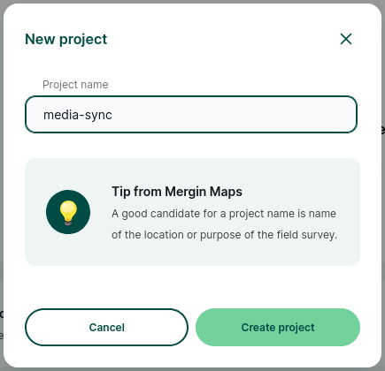
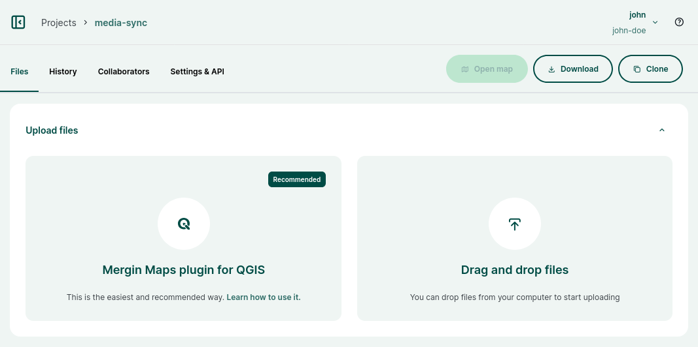
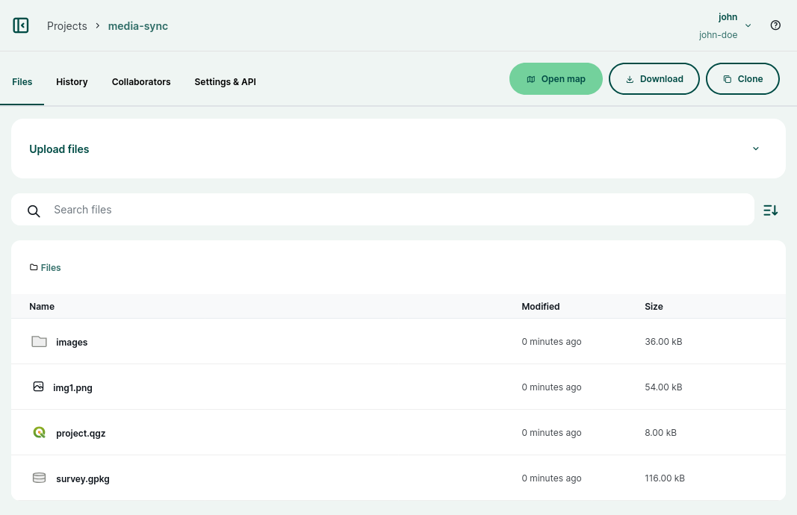

# Quick start guide

In this quick start guide you will set up one way synchronization between a new Mergin Maps project and an AWS S3 bucket (or use any other S3-compatible storage).

## Prerequisites

- AWS S3 bucket with readable files and access key for media-sync - follow [AWS S3 setup](aws-s3-setup.md) if you do not have one
  (or use [S3-compatible storage](#using-s3-compatible-storage))
- docker engine

## 1. Create an empty Mergin Maps project
Go to [Mergin Maps](https://app.merginmaps.com/) website and create a new project.



The new project does not contain any files yet.



Your full project name for later is `<workspace>/<project-name>`, e.g. `john-doe/media-sync`.

## 2. Set up QGIS project
Create a new QGIS project, add some layer (e.g. `notes` in `survey.gpkg`). Add few points and make sure you reference some pictures in attributes
(e.g. `photo`). Create additional column for new URL where files would be copied to (e.g. `external_url`). Attribute table of your layer may look like this:

| fid | name         | photo                   | external_url |
|-----|--------------|-------------------------|--------------|
| 1   | Tower Bridge | photos/Tower_Bridge.jpg | NULL         |
| 2   | Eiffel Tower | photos/Eiffel_Tower.jpg | NULL         |

Upload your project to Mergin Maps, either via [Mergin Maps plugin](https://github.com/MerginMaps/qgis-plugin) for QGIS or by drag and drop in web browser.



You have now your project ready in Mergin Maps.

## 3. Start syncing
Download and run media-sync docker image with configuration based on above (you will need to tweak that):

Note that you may need to escape some characters in your password or username

```shell
docker run -it \
  --name mergin-media-sync \
  -e MERGIN__USERNAME=john \
  -e MERGIN__PASSWORD=myStrongPassword \
  -e MERGIN__PROJECT_NAME=john-doe/media-sync \
  -e DRIVER=s3 \
  -e S3__BUCKET=my-media-bucket \
  -e S3__REGION=eu-west-1 \
  -e S3__ACCESS_KEY=<AccessKeyId> \
  -e S3__SECRET_KEY=<SecretAccessKey> \
  -e S3__CREATE_BUCKET=false \
  -e OPERATION_MODE=copy \
  -e REFERENCES="[{file='survey.gpkg', table='notes', local_path_column='photo', driver_path_column='external_url'}]" \
  lutraconsulting/mergin-media-sync python3 media_sync_daemon.py
```

and you should see photos copied from your Mergin Maps project to the bucket:

```shell
$ aws s3 ls s3://my-media-bucket --recursive
2026-11-02 10:15:03     326330 photos/Eiffel_Tower.jpg
2026-11-02 10:15:03     281774 photos/Tower_Bridge.jpg
```

Files are stored with correct content type, so they can be displayed directly in a browser:

```shell
$ curl -I https://my-media-bucket.s3.eu-west-1.amazonaws.com/photos/Tower_Bridge.jpg
HTTP/1.1 200 OK
Content-Type: image/jpeg
...
```

and your references in QGIS project are updated:

| fid | name         | photo                   | external_url                                                                 |
|-----|--------------|-------------------------|------------------------------------------------------------------------------|
| 1   | Tower Bridge | photos/Tower_Bridge.jpg | https://my-media-bucket.s3.eu-west-1.amazonaws.com/photos/Tower_Bridge.jpg |
| 2   | Eiffel Tower | photos/Eiffel_Tower.jpg | https://my-media-bucket.s3.eu-west-1.amazonaws.com/photos/Eiffel_Tower.jpg |

In `move` mode (`OPERATION_MODE=move`), photos are also removed from the Mergin Maps project and the `photo` column is cleared.

If you wish to specify folder within the bucket to store the files you can specify `S3__BUCKET_SUBPATH` variable
ie. `S3__BUCKET_SUBPATH=MyFolder` to store files in `MyFolder` instead of root of the bucket.

In order to stop syncing simply stop docker container.

## Using S3-compatible storage
Instead of AWS S3 you can use any S3-compatible storage by setting `S3__ENDPOINT`. See [S3-compatible storage](s3-compatible.md)
for how to run RustFS, Garage, SeaweedFS or Silo (community maintained MinIO fork) with media-sync.
