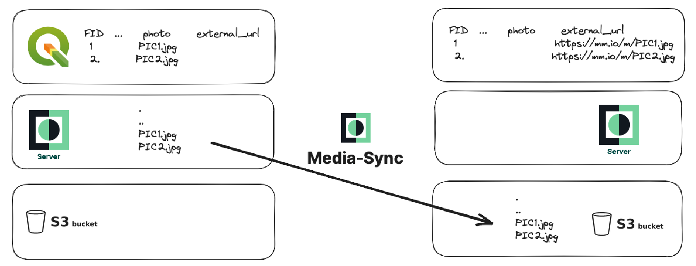

# Using Media Sync

Basic principle is that media-sync daemon COPY or MOVE your pictures from Mergin Maps server to other storage backend. Here is an example of MOVE operation:


Sync works in two modes, in COPY mode, where media files are only copied to external drive and MOVE mode, where files are
subsequently removed from Mergin Maps project (on cloud).

Also user can choose whether references to media files should be updated.

Only files needed for the sync are downloaded from the Mergin Maps project to the local checkout in
`<system temp dir>/mediasync/<project name>` - media files
with `allowed_extensions` (under `base_path` if set) and geopackages listed in `references`. Other project files (e.g. QGIS project,
basemaps) are not downloaded. If the configuration of synced files changes, the project is downloaded again.

**Please note double underscore `__` is used to separate [config](../config.yaml.default) group and item in environment variables.**

## Running with Docker
To run the container, use a command like the following one:
```shell
  docker run -it \
  -e MERGIN__USERNAME=john \
  -e MERGIN__PASSWORD=myStrongPassword \
  -e MERGIN__PROJECT_NAME=john/my_project \
  lutraconsulting/mergin-media-sync python3 media_sync_daemon.py
```
The sync process will start, regularly checking Mergin Maps service copy/move media files from a Mergin Maps project to an external storage.
Local drive is a default backend, you need to mount volume from host machine for data to persist.

## Update reference table in geopackage
If you want to modify references to media files in some geopackage in your project, please make sure you have two columns there,
one with reference to local file and another for external URL where file can be downloaded from.

To update references to media files (probably useful with MOVE mode), you can run:
```shell
docker run -it \
  -v /tmp/mediasync:/data \
  --name mergin-media-sync \
  -e MERGIN__USERNAME=john \
  -e MERGIN__PASSWORD=myStrongPassword \
  -e MERGIN__PROJECT_NAME=john/my_project \
  -e LOCAL__DEST=/data \
  -e OPERATION_MODE=move \
  -e REFERENCES="[{file='my_survey.gpkg', table='my_table', local_path_column='col_with_path', driver_path_column='col_with_ext_url'}]" \
  lutraconsulting/mergin-media-sync python3 media_sync_daemon.py
```
Make sure you have correct structure of your .gpkg file. Otherwise leave `REFERENCES` unset (no references are updated by default).

## Using S3 backend
To upload files to AWS S3 bucket, switch to `s3` driver:
```shell
docker run -it \
  --name mergin-media-sync \
  -e MERGIN__USERNAME=john \
  -e MERGIN__PASSWORD=myStrongPassword \
  -e MERGIN__PROJECT_NAME=john/my_project \
  -e DRIVER=s3 \
  -e S3__BUCKET=my-media-bucket \
  -e S3__REGION=eu-west-1 \
  -e S3__ACCESS_KEY=access-key \
  -e S3__SECRET_KEY=secret-key \
  -e S3__CREATE_BUCKET=false \
  lutraconsulting/mergin-media-sync python3 media_sync_daemon.py
```

| Setting | Description |
|---|---|
| `S3__BUCKET` | Name of the bucket (required). |
| `S3__REGION` | AWS region of the bucket, e.g. `eu-west-1`. Required for AWS S3. |
| `S3__ACCESS_KEY`, `S3__SECRET_KEY` | Access key of IAM user. If not set, [default AWS credentials chain](https://boto3.amazonaws.com/v1/documentation/api/latest/guide/credentials.html) is used (e.g. `AWS_*` environment variables or IAM role). |
| `S3__ENDPOINT` | Leave empty for AWS S3. For S3-compatible server either `host:port` or full URL, e.g. `https://s3.example.com`. |
| `S3__SECURE` | Use https for `S3__ENDPOINT` without scheme (default `true`). |
| `S3__BUCKET_SUBPATH` | Optional folder within the bucket to store files in, files are stored in the root of the bucket by default. |
| `S3__PUBLIC_URL` | Optional base URL used in references instead of the bucket URL, e.g. when files are served through CDN or reverse proxy. |
| `S3__ADDRESSING_STYLE` | `auto` (default), `path` or `virtual`. Some S3-compatible servers need `path`. |
| `S3__CREATE_BUCKET` | Create the bucket if it does not exist (default `true`). Set to `false` if the bucket is managed elsewhere and the user has no permission to create buckets. |

### S3-compatible storage
You can connect media-sync to any S3-compatible object storage backend by setting `S3__ENDPOINT`, e.g. for a self-hosted server:
```shell
docker run -it \
  --name mergin-media-sync \
  -e MERGIN__USERNAME=john \
  -e MERGIN__PASSWORD=myStrongPassword \
  -e MERGIN__PROJECT_NAME=john/my_project \
  -e DRIVER=s3 \
  -e S3__ENDPOINT="https://s3.example.com" \
  -e S3__ACCESS_KEY=access-key \
  -e S3__SECRET_KEY=secret-key \
  -e S3__BUCKET=destination-bucket \
  -e S3__ADDRESSING_STYLE=path \
  lutraconsulting/mergin-media-sync python3 media_sync_daemon.py
```

Currently we test integration with open source solutions like RustFS, Garage, SeaweedFS and Silo (community maintained MinIO fork) - see [S3-compatible storage](s3-compatible.md) for how to run them with media-sync and make uploaded files readable.

### Migration from MinIO driver
In previous releases (0.5.0 and older) we used MinIO as the default storage object backend but we migrated to AWS S3 since. The old setup is still supported but if you want to migrate to the new configuration you need to set `DRIVER=s3` and rename `MINIO__*` variables to `S3__*` (e.g. `MINIO__ACCESS_KEY` to `S3__ACCESS_KEY`). `S3__SECURE` defaults to `true`, so for a server on plain http use `http://` in `S3__ENDPOINT` (or set `S3__SECURE=false`).

## Using Google Drive backend
For setup instructions and more details, please refer to our [Google Drive guide](google-drive-setup.md).

## Running without Docker

1. set up configuration in config.yaml  (see [config.yaml.default](../config.yaml.default) for a sample)
2. all settings can be overridden with env variables (see docker examples above)
3. run media-sync
```shell
  pipenv run python3 media_sync.py
```

or as a daemon syncing periodically:
```shell
  pipenv run python3 media_sync_daemon.py
```

## Useful command line options of the daemon

- `config_file_name.yaml` The file name with path of yaml config can be provided. By default the tool uses `config.yaml` file from the current directory.

- `--log-file` specify file to store log info into. If it is not set the log info will only be printed to the console.

- `--log-verbosity` minimal level of messages stored in the log file - `DEBUG`, `INFO`, `WARNING`, `ERROR` or `CRITICAL`. Default is `INFO`.
